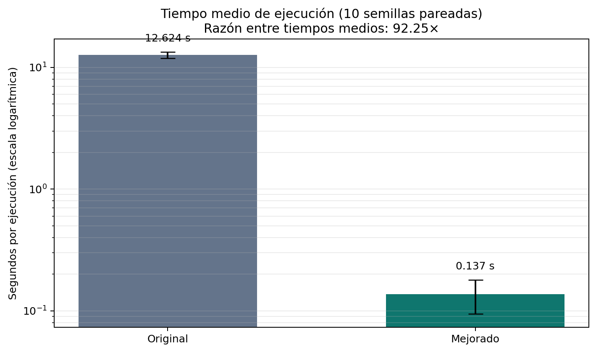
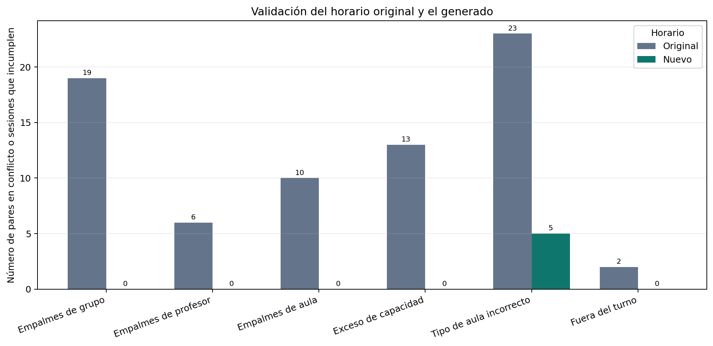
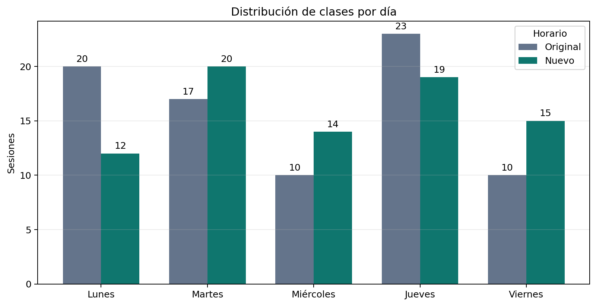
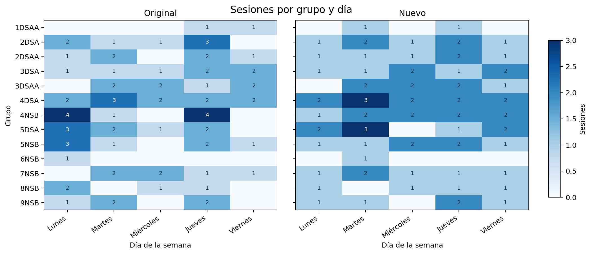
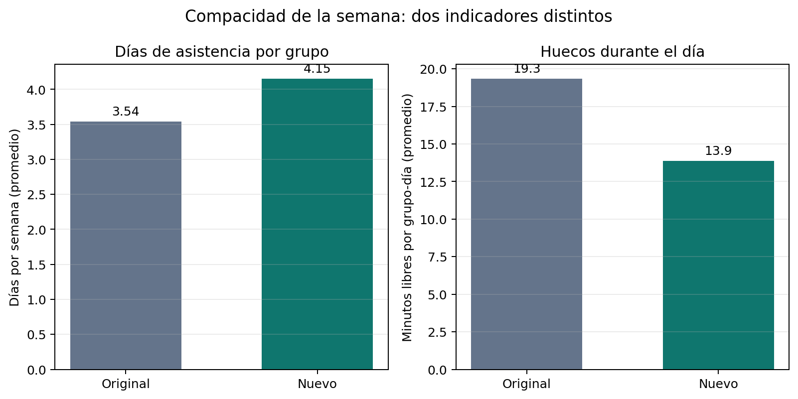

# Generador de horarios escolares con algoritmos genéticos

Proyecto de optimización para asignar sesiones de clase a aulas y franjas horarias. Incluye un algoritmo genético base, una versión mejorada, los datos de un periodo escolar y análisis reproducibles de rendimiento y calidad de los horarios.

> **Conclusión con los datos actuales:** la versión mejorada fue mucho más rápida en las 10 ejecuciones registradas; el horario generado también elimina los empalmes medidos en la asignación original. Sin embargo, distribuye los grupos en más días y deja cinco sesiones de laboratorio en un tipo de aula distinto al solicitado. La recomendación depende, por tanto, de si se prioriza evitar conflictos o compactar la semana.

## Resultados principales

Los valores de esta sección corresponden a los archivos disponibles en este repositorio. El script [generar_graficas_readme.py](./generar_graficas_readme.py) genera las imágenes utilizadas abajo; los notebooks permiten explorar los datos.

### Algoritmos: velocidad y aptitud

El benchmark de [comparacion_algoritmos.csv](./comparacion_algoritmos.csv) contiene **10 ejecuciones pareadas**, con semillas del 7 al 16, población de 120 individuos y un máximo de 400 generaciones.

| Métrica | Algoritmo original | Algoritmo mejorado |
|---|---:|---:|
| Tiempo medio por ejecución | 12.624 s | 0.137 s |
| Desviación estándar del tiempo | 0.759 s | 0.043 s |
| Tiempo mínimo–máximo | 11.626–13.995 s | 0.102–0.251 s |
| Generaciones observadas | 400 en las 10 ejecuciones | 1 en las 10 ejecuciones |
| Violaciones duras comunes promedio | 0 | 0 |
| Violaciones blandas comunes promedio | 5 | 5 |
| Fitness común promedio | 0.166667 | 0.166667 |

En estas mediciones, el mejorado redujo el tiempo medio **98.92 %**; la razón entre los tiempos medios fue **92.25×**. Esto describe las 10 ejecuciones registradas, no garantiza el mismo tiempo en otro equipo o conjunto de datos.



**Cómo interpretar la calidad:** `fitness_comun`, `duras_comun` y `blandas_comun` evalúan ambos resultados con las reglas del algoritmo original; no son una medida equivalente de todas las mejoras. En particular, el evaluador original detecta empalmes cuando dos sesiones usan el mismo identificador de franja, mientras que el mejorado compara intervalos horarios que pueden traslaparse. Por eso se muestran también las validaciones independientes del horario actual más abajo. El fitness propio de cada implementación tampoco debe compararse directamente porque sus restricciones y penalizaciones difieren.

### Horario del dataset frente al horario generado

Esta comparación evalúa [dataset/asignacion_actual.csv](./dataset/asignacion_actual.csv) frente a [horario_generado.csv](./horario_generado.csv), con las 80 sesiones esperadas de las 48 clases. Los choques se cuentan entre pares de clases del mismo día cuyos intervalos efectivamente se traslapan.

| Indicador | Asignación original | Horario generado |
|---|---:|---:|
| Empalmes del mismo grupo | 19 | 0 |
| Empalmes de profesor | 6 | 0 |
| Empalmes de aula | 10 | 0 |
| Sesiones que exceden la capacidad del aula | 13 | 0 |
| Sesiones con tipo de aula distinto al requerido | 23 | 5 |
| Sesiones fuera del turno del grupo | 2 | 0 |
| Días de asistencia por grupo, promedio | 3.54 | 4.15 |
| Tiempo libre entre clases por grupo-día, promedio | 19.3 min | 13.9 min |
| Mayor intervalo libre entre clases en un día | 6 h 30 min | 1 h 40 min |



El nuevo horario mejora los indicadores de conflictos, capacidad y turno, y reduce el mayor hueco entre clases. A cambio, suma **8 días-grupo** de asistencia a lo largo de la semana (46 frente a 54); es decir, reparte más las clases. Solo **1 de las 80 sesiones** conserva exactamente el mismo grupo, materia, día, hora y aula.

| Día | Sesiones originales | Sesiones nuevas |
|---|---:|---:|
| Lunes | 20 | 12 |
| Martes | 17 | 20 |
| Miércoles | 10 | 14 |
| Jueves | 23 | 19 |
| Viernes | 10 | 15 |







#### Pendiente de factibilidad de aulas

Las cinco sesiones nuevas que no cumplen el tipo de aula requerido corresponden a **Estructura de Datos** de los grupos 3DSAA y 3DSA, que solicita laboratorio de cómputo. El dataset estima 35 estudiantes por grupo, pero los laboratorios de cómputo disponibles tienen capacidad estimada de 32. El algoritmo mejorado relaja el tipo de aula cuando no encuentra una que cumpla simultáneamente tipo y capacidad; así evita el sobrecupo, pero asigna esas sesiones a otras aulas. Para que el horario sea plenamente factible, se necesita un laboratorio con capacidad suficiente o una decisión explícita de modificar el requisito, el aforo o la división del grupo.

### ¿Cuál es mejor?

- **Para evitar empalmes y sobrecupos:** el horario generado es mejor según las validaciones realizadas: no registra esos conflictos, respeta los turnos y evita exceder la capacidad estimada.
- **Para concentrar las clases en menos días:** la asignación original es más compacta en promedio (3.54 días por grupo frente a 4.15).
- **Para cumplimiento completo de aulas:** ninguno es perfecto; el original presenta 23 incompatibilidades de tipo y el generado 5. Estas cifras reflejan los datos del CSV y la capacidad estimada, no una inspección de disponibilidad real del plantel.
- **Para tiempo de cálculo:** el mejorado fue superior en el benchmark registrado, con la salvedad de que en esas ejecuciones ambos obtuvieron la misma puntuación bajo el evaluador común.

**Balance:** el horario generado es la mejor base operativa de los dos, pero las asignaciones de Estructura de Datos deben resolverse antes de adoptarlo. Si reducir los días de asistencia es un objetivo importante, conviene incluirlo explícitamente en la función de aptitud y volver a generar el horario.

## Fundamentos: algoritmo genético

Un algoritmo genético (AG) busca buenas soluciones mediante una población de soluciones candidatas. La aptitud puntúa cada solución; selección, cruce y mutación producen nuevas candidatas y el ciclo se repite hasta alcanzar un criterio de parada. El enfoque es útil cuando el espacio combinatorio es grande y existen varias restricciones simultáneas; no garantiza por sí solo hallar una solución óptima.

En este problema, un **cromosoma** representa las asignaciones de aula y horario de todas las sesiones. Cada gen codifica el aula y la franja de una sesión; los datos fijos del curso (grupo, profesor, materia y estudiantes) se cargan desde el dataset. El cromosoma es el *genotipo* y el horario legible es su *fenotipo*.

El código asigna pesos mayores a las restricciones duras que a las blandas y calcula la aptitud como:

```text
costo   = W_H × violaciones_duras + W_S × violaciones_blandas
fitness = 1 / (1 + costo)
```

Un fitness más alto significa menor costo para las reglas de **esa implementación**. En el algoritmo original, por ejemplo, rebasar la capacidad o coincidir en la misma franja exacta se penaliza como duro; el tipo de aula incorrecto y el exceso de espacio se penalizan como blandos. La versión mejorada incorpora filtros de aulas y turnos, detección de traslapes por intervalo, cruce por clase, mutación dirigida, reparación local y parada temprana.

### Diferencias entre las implementaciones

| Aspecto | Original | Mejorado |
|---|---|---|
| Espacio de búsqueda inicial | Cualquier aula y franja disponibles | Aulas candidatas filtradas por capacidad/tipo y franjas por turno, con relajación si no hay candidatos |
| Detección de empalmes | Requiere el mismo identificador de horario | Comprueba traslapes de tiempo en el mismo día |
| Cruce | Uniforme por gen | Hereda en bloque las sesiones de cada clase |
| Mutación | Aleatoria | Dirigida a sesiones conflictivas y adaptativa |
| Búsqueda local | No | Reparación memética de asignaciones en conflicto |
| Criterio de parada | Fitness perfecto o límite de generaciones | Cota mínima del costo o estancamiento, además del límite |

La versión mejorada no es solo una aceleración del mismo evaluador: agrega restricciones y cambia los operadores. Se debe comparar tanto su rendimiento como la factibilidad del horario que produce.

## Flujo del proyecto

1. Los CSV de `dataset/` describen clases, espacios disponibles, franjas y asignaciones actuales.
2. Cada algoritmo representa cada sesión con una asignación de aula y franja, genera candidatos y calcula su aptitud.
3. La versión mejorada exporta el mejor cromosoma como `horario_generado.csv`.
4. `comparar_algoritmos.py` ejecuta ambos algoritmos con las mismas semillas y guarda medidas de tiempo, generaciones y aptitud en `comparacion_algoritmos.csv`.
5. Los notebooks generan análisis exploratorios; `generar_graficas_readme.py` produce las imágenes estáticas de este README.

## Estructura del repositorio

```text
.
├── dataset/
│   ├── OFERTA ACADEMICA ENE-JUN2024 H.pdf
│   ├── asignacion_actual.csv
│   ├── aulas.csv
│   ├── build_dataset.py
│   ├── clases.csv
│   └── horarios.csv
├── analisis_comparativo_algoritmos.ipynb
├── analisis_comparativo_horarios.ipynb
├── better_genetic_schedule.py
├── comparar_algoritmos.py
├── comparacion_algoritmos.csv
├── genetic_schedule.py
├── horario_generado.csv
├── generar_graficas_readme.py
└── docs/
    └── figures/
```

### Archivos principales

- [genetic_schedule.py](./genetic_schedule.py): implementación base del algoritmo genético.
- [better_genetic_schedule.py](./better_genetic_schedule.py): implementación mejorada y exportación del horario resultante.
- [comparar_algoritmos.py](./comparar_algoritmos.py): benchmark pareado para ambos algoritmos.
- [analisis_comparativo_algoritmos.ipynb](./analisis_comparativo_algoritmos.ipynb): estadística y gráficos del benchmark guardado; permite configurar nuevas ejecuciones.
- [analisis_comparativo_horarios.ipynb](./analisis_comparativo_horarios.ipynb): comparación interactiva de horarios, restricciones, distribución semanal y vista por grupo.
- [dataset/build_dataset.py](./dataset/build_dataset.py): construcción de los CSV a partir de la oferta académica.

## Ejecución

Se requiere Python 3. Para ejecutar la versión mejorada desde la carpeta raíz:

```bash
python better_genetic_schedule.py
```

El programa muestra el resultado y escribe `horario_generado.csv`, reemplazando el archivo existente.

Para ejecutar el algoritmo original:

```bash
python genetic_schedule.py
```

Para repetir el benchmark de 10 ejecuciones, usando semillas de 7 a 16:

```bash
python comparar_algoritmos.py --runs 10 --population 120 --generations 400 --seed 7 --output comparacion_algoritmos_nueva.csv
```

El parámetro `--output` evita sobrescribir `comparacion_algoritmos.csv`. Las ejecuciones pueden tardar; en el experimento registrado, las del algoritmo original se acercaron al límite de 400 generaciones.

### Ejecutar los notebooks

Instala las dependencias de visualización y Jupyter:

```bash
python -m pip install pandas matplotlib jupyter
```

Abre el repositorio en VS Code o ejecuta:

```bash
jupyter lab
```

Selecciona un entorno de Python con las dependencias instaladas y ejecuta las celdas en orden.

### Regenerar las gráficas del README

Con Matplotlib instalado:

```bash
python generar_graficas_readme.py
```

Las imágenes se guardan en `docs/figures/` a partir de los CSV actuales. Si se regeneró el horario o el benchmark, vuelve a ejecutar este comando para actualizar las gráficas.

## Datos y limitaciones

- El dataset de ejemplo tiene **48 clases, 80 sesiones requeridas, 13 grupos, 21 aulas y 45 franjas horarias**.
- La capacidad de cada aula y el aforo de cada clase son estimaciones registradas en los CSV.
- La medición de empalmes de este README compara intervalos reales, incluso si dos sesiones tienen distintos identificadores de franja.
- Las ejecuciones estocásticas dependen de semillas, parámetros, hardware y carga del equipo. Diez ejecuciones son una muestra comparativa, no una garantía de desempeño.
- El horario generado es una salida de optimización, no una asignación institucional aprobada. Confirma la disponibilidad real de aulas, docentes y grupos antes de utilizarlo.
- Las gráficas y tablas reflejan el estado de los archivos CSV al momento de generarlas; pueden quedar desactualizadas después de volver a ejecutar los algoritmos.

## Referencia teórica

La explicación introductoria de algoritmos genéticos, representación cromosómica, selección, cruce, mutación y restricciones se elaboró con apoyo del documento proporcionado **Algoritmos Genéticos y su Aplicación** (`Algoritmos Geneticos.docx`). La descripción de cada operador y de las reglas específicas del proyecto se contrastó con el código fuente del repositorio.
